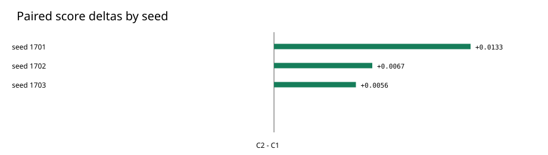

# ReasonForge-PT

**Evidence-controlled foundation-model post-training and evaluation on Qwen3-4B.**

ReasonForge-PT asks whether an adaptive task curriculum improves generalization over a matched conventional recipe. Both 4B arms start from the same frozen Qwen3-4B SFT/QLoRA adapter, use the same training and evaluation budget, and differ in task selection: **C1** samples uniformly; **C2** uses Reliability-Constrained Adaptive Curriculum (RCAC). The locked comparison spans three seeds.

## Main result

| Locked 4B comparison | Result |
|---|---:|
| Model | Qwen3-4B |
| Seeds | 3 |
| Paired cells | 150 examples × 3 seeds |
| C2 − C1 | +0.008519 |
| Seed-stratified 95% interval | [-0.006296, +0.025556] |
| Frozen promotion threshold | +0.030000 |
| Decision | **RETAIN_CONVENTIONAL_4B** |

All three seed-level differences were small and positive. The interval includes zero and the frozen +0.03 promotion gate was not met. **RCAC was not promoted; +0.008519 is an observed estimate, not an established improvement.** The decision was frozen before the later diagnostic analyses.



The value of this case is the decision process: build competing recipes, freeze evaluation before final outcomes, compare them on the same locked examples across seeds, retain the conventional recipe when evidence is insufficient, and investigate the result without moving the promotion gate.

## What the system examines

The evidence-controlled workflow combines a shared SFT/QLoRA starting point, matched GRPO post-training, deterministic task selection, protected scoring, seed-aware paired inference, and forward-only provenance records. The public code includes the curriculum, training, evaluation, statistics, and evidence utilities; runtime checkpoints and model artifacts are excluded.

Post-final diagnostics cover 1,452 evaluation units and 558 matched C1/C2 pairs, recovery/regression and failure transitions, robustness, 1,800 stochastic-generation rollouts, uncertainty-quality association and risk coverage, generation-policy sensitivity, routing validation, and timestamp-aware systems telemetry. A 60-pair blinded human-review packet was prepared, but labels remain pending. Routing showed **no robust held-out benefit**; uncertainty does **not** establish calibrated production probabilities.

Selected [aggregate tables](reports/tables/) and [figures](reports/figures/) illustrate these findings. The [scorecard](reports/final/MODEL_QUALITY_SCORECARD.md) keeps the frozen primary result separate from post-final diagnostics.

## Reproducibility

The lightweight public checks require Python 3.11 and do not download a model:

```bash
python -m pip install -e ".[dev]"
python -m ruff check .
python -m pytest -q
python scripts/validate_public_release.py
```

Full GPU reproduction requires the pinned Qwen3-4B revision, licensed source data, qualified CUDA hardware, and the frozen training/evaluation protocol. Those large and restricted inputs are absent here. See [methodology](docs/methodology.md), [reproducibility](docs/reproducibility.md), [licensing](docs/licensing.md), and [claim boundaries](docs/claim_boundaries.md).

## Repository map

`src/reasonforge/` contains the research implementation; `configs/` holds representative frozen recipes; `scripts/` and `tests/` provide portable validation; `docs/` explains the design; `reports/` contains selected aggregates and figures; `evidence/release/` contains a **derived public summary**, not the original checkpoint manifest.

## Limits and status

Three seeds do not support high-powered population inference. Public-benchmark pretraining contamination cannot be excluded. Exploratory slices and routing are not promotion evidence; systems measurements apply to the observed replay environment. Human labels did not enter the decision. [Further limitations](docs/limitations.md).

The authoritative decision is **RETAIN_CONVENTIONAL_4B**. The internal post-final release reached `CP110_POST_CP100_ANALYTICS_COMPLETE`: 167 bound artifacts, 37/37 final integrity checks, and 16 passing tests with one expected xfail. These are internal release checks; this public export has its own CPU-safe CI suite. The public summary is derived from that release and does not replace its scientific evidence.
